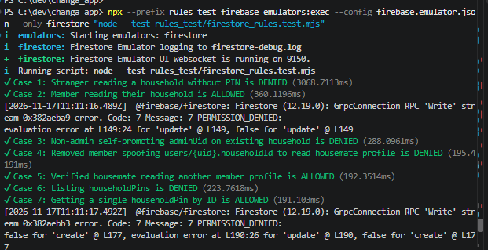
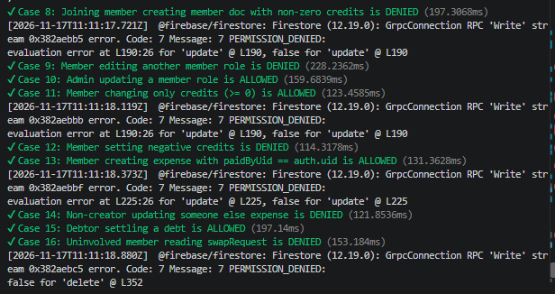
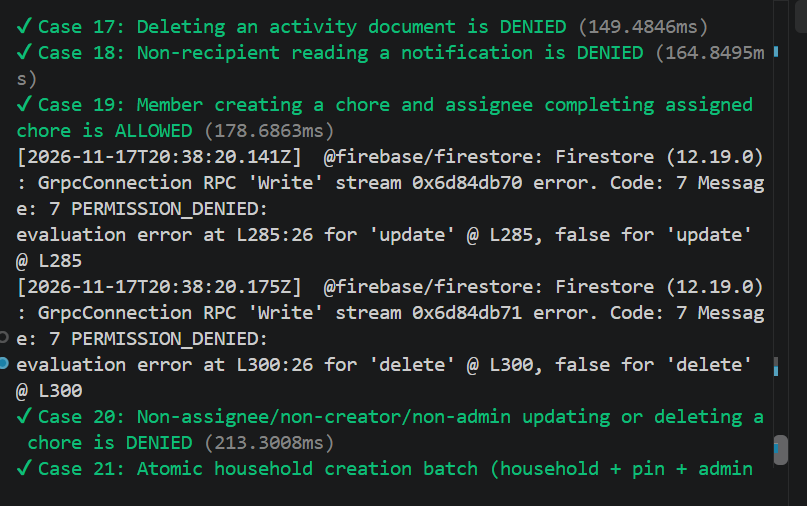
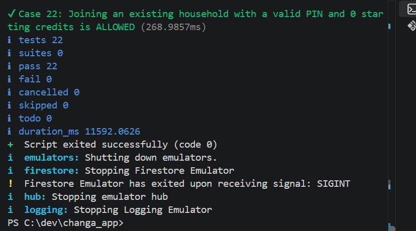

<!--Security rules test cases and execution log (Task B14) -->

# Cloud Firestore Security Rules Test Suite (`B14`)

This document records **22 security rules verification cases** (Allowed & Denied) across all 10 collections executed against `firestore.rules` using the **Firebase Local Emulator Suite** (`@firebase/rules-unit-testing`) and **Firebase Rules Playground**.

---

## Test Fixture Summary

| Entity | Path | Seeded Data |
| :--- | :--- | :--- |
| **Admin User** | `/users/amara` | `{ fullName: "Amara Okoye", email: "amara@alu.edu", phone: "0780000001", householdId: "house-1" }` |
| **Member User** | `/users/kevin` | `{ fullName: "Kevin Mugisha", email: "kevin@alu.edu", phone: "0780000002", householdId: "house-1" }` |
| **Third Member** | `/users/grace` | `{ fullName: "Grace Uwimana", email: "grace@alu.edu", phone: "0780000003", householdId: "house-1" }` |
| **Stranger / Removed** | `/users/stranger` | `{ fullName: "Removed User", email: "stranger@alu.edu", phone: "0780000009", householdId: "house-1" }` *(no `/members/stranger` doc)* |
| **Household** | `/households/house-1` | `{ name: "Kigali Nest", type: "apartment", expectedMembers: 4, pin: "482916", adminUid: "amara" }` |
| **Admin Member Doc** | `/households/house-1/members/amara` | `{ role: "admin", credits: 40, joinedAt: Timestamp }` |
| **Regular Member Doc** | `/households/house-1/members/kevin` | `{ role: "member", credits: 20, joinedAt: Timestamp }` |
| **Household PIN** | `/householdPins/482916` | `{ householdId: "house-1", createdAt: Timestamp }` |
| **Chore Doc** | `/households/house-1/chores/chore-1` | `{ title: "Clean kitchen", difficulty: "medium", assignedToUid: "kevin", status: "pending", createdByUid: "amara" }` |

---

## Summary Table of 22 Test Cases

| # | Collection | Operation | Caller (`auth.uid`) | Scenario | Expected | Actual |
| :-: | :--- | :--- | :--- | :--- | :---: | :---: |
| **1** | `households` | `get` | `stranger` | Stranger reading a household without membership or active PIN lookup | **DENIED** | PASS (Denied) |
| **2** | `households` | `get` | `kevin` | Verified household member reading their household document | **ALLOWED** | PASS (Allowed) |
| **3** | `households` | `update` | `kevin` | Non-admin attempting to self-promote `adminUid` on an existing household | **DENIED** | PASS (Denied) |
| **4** | `users` | `get` | `stranger` | Removed user spoofing `users/stranger.householdId = "house-1"` to read a housemate profile | **DENIED** | PASS (Denied) |
| **5** | `users` | `get` | `kevin` | Verified housemate reading another member's `/users/amara` profile | **ALLOWED** | PASS (Allowed) |
| **6** | `householdPins` | `list` | `kevin` | Signed-in user attempting to list/enumerate `/householdPins` | **DENIED** | PASS (Denied) |
| **7** | `householdPins` | `get` | `stranger` | Signed-in user reading a single `/householdPins/482916` document by PIN | **ALLOWED** | PASS (Allowed) |
| **8** | `members` | `create` | `newJoiner` | Joining member attempting to create their member doc with `credits: 100` (non-zero starting credits) | **DENIED** | PASS (Denied) |
| **9** | `members` | `update` | `kevin` | Regular member attempting to edit another member's `role` to `"admin"` | **DENIED** | PASS (Denied) |
| **10** | `members` | `update` | `amara` | Household admin updating a member's `role` during admin transfer | **ALLOWED** | PASS (Allowed) |
| **11** | `members` | `update` | `kevin` | Member updating only the `credits` field with a non-negative value (`credits: 30`) | **ALLOWED** | PASS (Allowed) |
| **12** | `members` | `update` | `kevin` | Member attempting to update `credits` to a negative value (`credits: -10`) | **DENIED** | PASS (Denied) |
| **13** | `expenses` | `create` | `kevin` | Member creating an expense where `paidByUid` matches `request.auth.uid` and `totalAmount > 0` | **ALLOWED** | PASS (Allowed) |
| **14** | `expenses` | `update` | `kevin` | Non-creator attempting to edit an expense paid by `amara` | **DENIED** | PASS (Denied) |
| **15** | `debts` | `update` | `kevin` | Debtor settling a debt by updating `status`, `settlementMethod`, and `settledAt` | **ALLOWED** | PASS (Allowed) |
| **16** | `swapRequests` | `read` | `grace` | Uninvolved household member (`grace`) reading a swap request between `amara` and `kevin` | **DENIED** | PASS (Denied) |
| **17** | `activities` | `delete` | `amara` | Admin attempting to delete or mutate an immutable activity feed entry | **DENIED** | PASS (Denied) |
| **18** | `notifications` | `get` | `amara` | Non-recipient (`amara`) attempting to read a notification addressed to `kevin` | **DENIED** | PASS (Denied) |
| **19** | `chores` | `create` / `update` | `kevin` | Member creating a chore (`createdByUid == auth.uid`) and assignee marking their assigned chore `done` with `creditsAwarded` | **ALLOWED** | PASS (Allowed) |
| **20** | `chores` | `update` / `delete` | `grace` | Non-assignee, non-creator, non-admin (`grace`) attempting to complete or delete someone else's chore | **DENIED** | PASS (Denied) |
| **21** | `households` / `householdPins` / `members` | `batch.commit` (`create`) | `newAdmin` | Atomic `createHousehold` batch creating household, 6-digit PIN, and admin member doc with `credits: 0` via `isCreatingHouseholdAsAdmin` | **ALLOWED** | PASS (Allowed) |
| **22** | `members` / `activities` | `batch.commit` (`create`) | `newJoiner` | Legitimate `joinHousehold` batch creating member doc with `role: "member"`, `credits: 0` (matching active PIN) and `memberJoined` activity | **ALLOWED** | PASS (Allowed) |

---

## Detailed Test Cases & Evidence

### Group 1: Household Creation, Joining & User Profile Rules (Cases 1 - 5, 21 - 22)
- **Case 1 (DENIED):** `stranger` calling `get` on `/households/house-private` without membership or active PIN lookup.
- **Case 2 (ALLOWED):** `kevin` calling `get` on `/households/house-1` as a verified member.
- **Case 3 (DENIED):** `kevin` attempting to self-promote `adminUid` on `/households/house-1` (`isAdmin` checks pre-write state only).
- **Case 4 (DENIED):** `stranger` spoofing `users/stranger.householdId = "house-1"` to read `/users/amara` without a `/members/stranger` doc.
- **Case 5 (ALLOWED):** `kevin` reading housemate profile `/users/amara`.
- **Case 21 (ALLOWED):** `newAdmin` committing an atomic `createHousehold` batch (`/households/house-new`, `/householdPins/123456`, `/households/house-new/members/newAdmin` with `role: "admin", credits: 0`), authorized by `isCreatingHouseholdAsAdmin("house-new")`.
- **Case 22 (ALLOWED):** `newJoiner` committing a `joinHousehold` batch (`/households/house-1/members/newJoiner` with `role: "member", credits: 0` and `/households/house-1/activities/act-join`), verified against `/householdPins/482916`.

### Group 2: PINs & Membership Management (Cases 6 - 12)
- **Case 6 (DENIED):** `kevin` attempting `list` on `/householdPins`.
- **Case 7 (ALLOWED):** `stranger` calling single-doc `get` on `/householdPins/482916`.
- **Case 8 (DENIED):** `newJoiner` attempting to create `/households/house-1/members/newJoiner` with `credits: 100` (`credits == 0` enforced on create).
- **Case 9 (DENIED):** `kevin` attempting to update `/households/house-1/members/grace` with `{ role: "admin" }`.
- **Case 10 (ALLOWED):** `amara` (admin) updating `/households/house-1/members/kevin` with `{ role: "admin" }`.
- **Case 11 (ALLOWED):** `kevin` updating only `credits` to `30` (`>= 0`).
- **Case 12 (DENIED):** `kevin` attempting to update `credits` to `-10`.

### Group 3: Expenses & Debts (Cases 13 - 15)
- **Case 13 (ALLOWED):** `kevin` creating `/households/house-1/expenses/exp-new` with `paidByUid == "kevin"` and `totalAmount: 24000`.
- **Case 14 (DENIED):** `kevin` attempting to update `/households/house-1/expenses/exp-amara` where `paidByUid == "amara"`.
- **Case 15 (ALLOWED):** `kevin` (debtor) settling `/households/house-1/debts/debt-1` with `{ status: "settled", settlementMethod: "momo", settledAt }`.

### Group 4: Chores, Swap Requests, Activities & Notifications (Cases 16 - 20)
- **Case 16 (DENIED):** `grace` attempting to read `/households/house-1/swapRequests/swap-1` between `amara` and `kevin`.
- **Case 17 (DENIED):** `amara` attempting to `delete` `/households/house-1/activities/act-1` (activities are immutable).
- **Case 18 (DENIED):** `amara` attempting to `get` `/households/house-1/notifications/notif-1` where `recipientUid == "kevin"`.
- **Case 19 (ALLOWED):** `kevin` creating `/households/house-1/chores/chore-new` (`createdByUid == "kevin"`) and completing assigned `/households/house-1/chores/chore-1` (`status: "done"`, `completedAt`, `creditsAwarded: 20`).
- **Case 20 (DENIED):** `grace` (neither admin, creator, nor assignee) attempting to complete or delete `/households/house-1/chores/chore-1`.

### Screenshots

